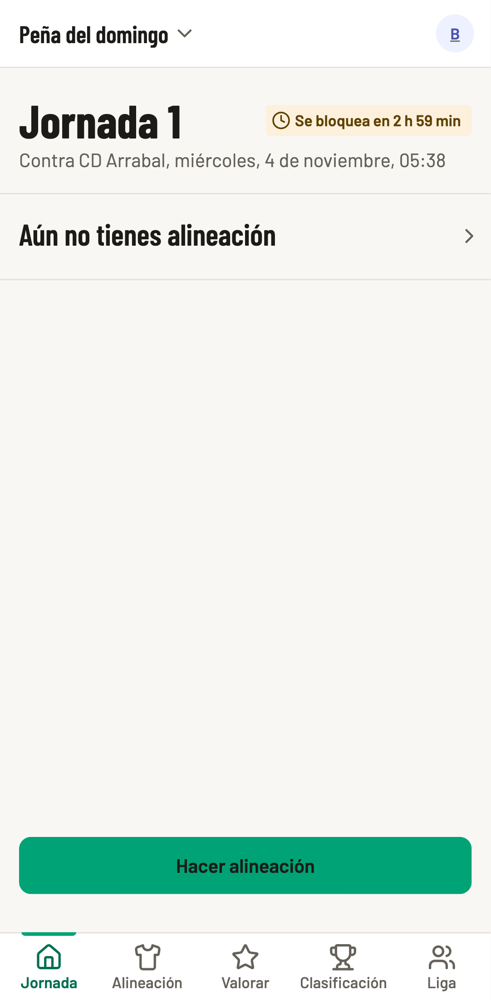
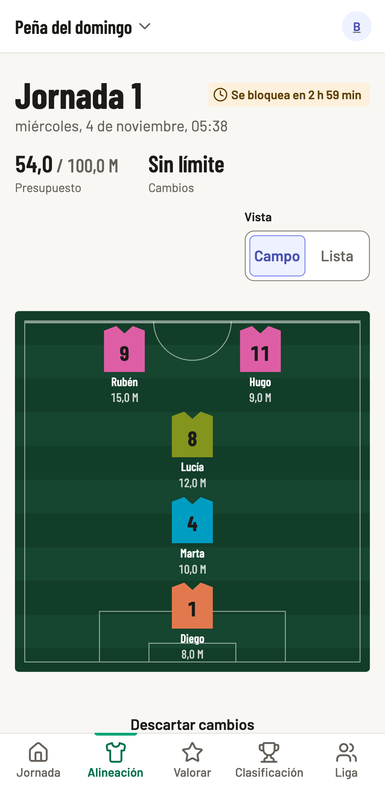
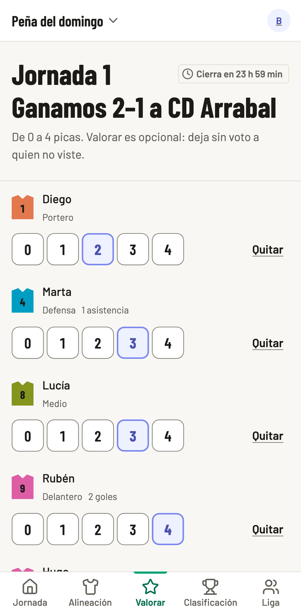
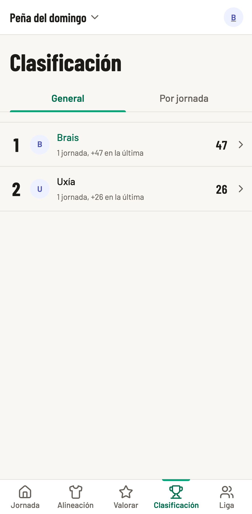
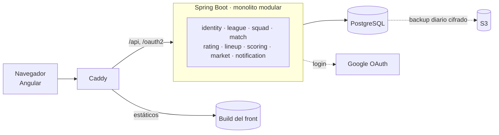

# buddy-fantasy

Fantasy para una liga de peñas de domingo.

[](https://github.com/xosebabio/buddy-fantasy/actions/workflows/ci.yml)
[](LICENSE)

<p align="center">
  
  
  
  
</p>

## Qué es

Un administrador registra **un único equipo real** por liga, con sus partidos y el acta de cada uno (resultado y estadísticas). Los managers montan su alineación con un presupuesto y un límite de cambios, **valoran a los jugadores** tras cada partido y compiten en una clasificación. Los roles son por liga y el administrador también juega como manager.

La app corre en [buddyfantasy.com](https://buddyfantasy.com), pero es una liga privada por invitación: no hay registro abierto. Sus textos legales son [`/privacy`](https://buddyfantasy.com/privacy) y [`/terms`](https://buddyfantasy.com/terms). El detalle funcional está en [`docs/requirements.md`](docs/requirements.md).

## Un proyecto de aprendizaje en producción

buddy-fantasy es un proyecto personal para aprender haciendo, con usuarios reales: un grupo de amigos que juega de verdad. Los dos lados son intencionados.

- **Aprender.** Por eso hay piezas más serias de lo que pide una liga de amigos. Se quería practicar arquitectura backend (monolito modular, hexagonal, eventos de dominio con Spring Modulith), frontend moderno (Angular zoneless con signals, librería de componentes propia, accesibilidad), operar en producción (Docker, CI/CD, VPS, backups, RGPD) y trabajar con agentes de IA.
- **Producción.** Por eso se toma en serio lo que cuesta tener usuarios reales: backups cifrados, RGPD, CSP, E2E y despliegue con vuelta atrás.

| Lo que pide una liga de amigos | Lo que hay y por qué                                                                |
| ------------------------------ | ----------------------------------------------------------------------------------- |
| Una hoja de cálculo            | Monolito modular con módulos verificados por test, para poder extraer uno algún día |
| Que alguien lo apunte          | Plazos y cálculos en el servidor, idempotentes: recalcular da el mismo resultado    |
| Confiar en los amigos          | Valoraciones anónimas y autorización por rol y liga en cada endpoint                |
| «Ya lo arreglo si falla»       | Backups diarios cifrados, vuelta atrás y E2E móviles con accesibilidad              |

Lo que **no** es: un producto comercial, una app de registro abierto ni un proyecto con soporte.

## Estado

| Fase | Contenido                                                                   | Estado    |
| ---- | --------------------------------------------------------------------------- | --------- |
| 0    | Fundamentos: modelo base, login con Google, esqueleto del front, despliegue | En curso  |
| 1    | Núcleo jugable: ligas, plantilla, partidos, alineaciones y puntos           | Hecha     |
| 2    | Valoraciones de los managers                                                | En curso  |
| 3    | Mercado de valores y notificaciones                                         | Pendiente |
| 4    | Pulido y operación                                                          | Pendiente |
| 5    | Escalado a cloud                                                            | Pendiente |

El detalle vive en [`docs/agents/status.md`](docs/agents/status.md) y el roadmap, en [`docs/requirements.md`](docs/requirements.md#roadmap-por-fases).

## Arquitectura



Dos ideas la sostienen:

- **Monolito modular con Spring Modulith.** Cada módulo es dueño de sus tablas y solo se habla con otros por su API pública o por eventos de dominio (`MatchClosed`, `RatingWindowClosed`, `MatchdayScored`…). Dentro de cada módulo, arquitectura hexagonal.
- **El contrato OpenAPI** (`api/openapi.json`, versionado) es la fuente de los tipos del frontend: el cliente nunca los escribe a mano.

| Módulo           | Responsabilidad                                              |
| ---------------- | ------------------------------------------------------------ |
| `identity`       | Usuarios, login, perfil y sesiones                           |
| `league`         | Ligas, membresías, roles por liga, invitaciones y parámetros |
| `squad`          | Jugadores del equipo real y su ficha                         |
| `match`          | Partidos, convocatoria, resultado y estadísticas             |
| `rating`         | Ventana y valoraciones de los managers                       |
| `lineup`         | Alineaciones, bloqueo y límite de cambios                    |
| `scoring`        | Puntos por jugador y manager, y clasificaciones              |
| `market`         | Valor de mercado de los jugadores                            |
| `notification`   | Web Push, email, preferencias y centro de avisos             |
| `datadefinition` | Definiciones de datos compartidas sin lógica                 |

Más en [`docs/agents/architecture.md`](docs/agents/architecture.md).

## Stack

| Capa          | Tecnología                                                              |
| ------------- | ----------------------------------------------------------------------- |
| Backend       | Java 21, Spring Boot 3, Spring Modulith                                 |
| Base de datos | PostgreSQL + Flyway                                                     |
| Autenticación | Spring Security con login solo de Google, sesión en Spring Session JDBC |
| Jobs          | `@Scheduled` + ShedLock                                                 |
| Frontend      | Angular mobile first (standalone, zoneless, signals), SCSS con tokens   |
| Imágenes      | S3 (SeaweedFS en local y en tests)                                      |
| Infra         | Docker Compose (app + Postgres + Caddy), GitHub Actions                 |

## Decisiones técnicas destacadas

- **Límites y defaults en configuración**, nunca en código ni en anotaciones: se comprueban en el dominio en cada escritura ([`docs/agents/conventions.md`](docs/agents/conventions.md)).
- **Eventos y jobs idempotentes.** Todo `@Scheduled` lleva ShedLock y todo listener tolera recibir el mismo evento dos veces ([`docs/agents/architecture.md`](docs/agents/architecture.md#invariantes-técnicas)).
- **Reloj inyectable y plazos en el servidor**: el bloqueo de alineaciones y el cierre de valoraciones nunca dependen del cliente.
- **Valoraciones anónimas**: ninguna API devuelve votos individuales, ni siquiera al administrador ([`docs/09-ratings-plan.md`](docs/09-ratings-plan.md)).
- **Testcontainers y tests de arquitectura** que fallan si se rompen Modulith o la hexagonal ([`docs/07-integration-tests-plan.md`](docs/07-integration-tests-plan.md)).
- **Frontend con reglas comprobadas por lint**: límites entre capas, estilos solo con tokens y textos con id estable ([`docs/10-frontend-requirements-plan.md`](docs/10-frontend-requirements-plan.md)).
- **E2E móvil con axe y CSP** sobre el build servido por Caddy, como en producción.
- **Backups cifrados con `age`** en S3 y vuelta atrás del despliegue ([`docs/14-deploy-plan.md`](docs/14-deploy-plan.md)).

## Cómo se trabaja

- [`docs/requirements.md`](docs/requirements.md) es la fuente de verdad funcional.
- Cada módulo tiene su plan numerado en `docs/NN-*-plan.md`, con sus decisiones y un _Orden de ejecución_.
- El repo se trabaja con agentes de código: [`AGENTS.md`](AGENTS.md) y [`docs/agents/`](docs/agents/) son su guía, y el flujo es requisitos → plan → agente → revisión. Por eso la documentación es tan detallada.
- `develop` es la rama de integración y `main`, producción, protegida. Commits en Conventional Commits, citando `RF-xx`.

## Arrancar en local

Requisitos: Java 21, Maven, Node 26 LTS (el de `frontend/.nvmrc`) y Docker.

```bash
docker compose -f deploy/docker-compose.dev.yml up -d   # Postgres y SeaweedFS
cd backend
S3_ENDPOINT=http://localhost:8333 AWS_ACCESS_KEY_ID=buddyfantasy AWS_SECRET_ACCESS_KEY=buddyfantasy-local \
  mvn spring-boot:run                                   # backend en :8080
# en otra terminal
cd frontend
npm ci && npm start                                     # front en http://localhost:4200
```

Para entrar hace falta un cliente OAuth propio de Google (`GOOGLE_CLIENT_ID` y `GOOGLE_CLIENT_SECRET`) o el perfil `e2e` (`SPRING_PROFILES_ACTIVE=e2e`, solo local). Ver [`docs/agents/commands.md`](docs/agents/commands.md) para el resto de comandos y variables.

## Tests

Unitarios, integración con Testcontainers (nunca H2), arquitectura, Vitest en el front y Playwright en móvil.

```bash
cd backend && mvn -B verify      # todo el backend (requiere Docker)
cd frontend && npm test          # Vitest
cd frontend && npm run e2e       # Playwright (ver commands.md)
```

Más en [`docs/agents/testing.md`](docs/agents/testing.md).

## Despliegue

Imágenes en GHCR, Docker Compose con Caddy en un VPS, despliegue automático desde `main` con comprobación de humo y backups diarios cifrados en S3. Servidor, DNS, Google, AWS, vuelta atrás y restauración están en [`deploy/README.md`](deploy/README.md).

## Estructura del repo

```
backend/    # Spring Boot (Maven)
frontend/   # Angular, web mobile first
api/        # openapi.json versionado, del que salen los tipos del frontend
deploy/     # Compose, Caddyfile, scripts de backup
docs/       # requisitos, planes y guías para agentes (docs/agents/)
```

## Licencia, contacto y privacidad

Código bajo licencia [MIT](LICENSE). Cubre el código, no los datos de la liga ni los textos legales, que llevan nombre propio: quien reutilice el proyecto debe escribir los suyos.

Es un proyecto personal: los issues son bienvenidos y los PR, mejor tras hablarlo en un issue. Contacto y asuntos de privacidad: docksidegarage@gmail.com.
